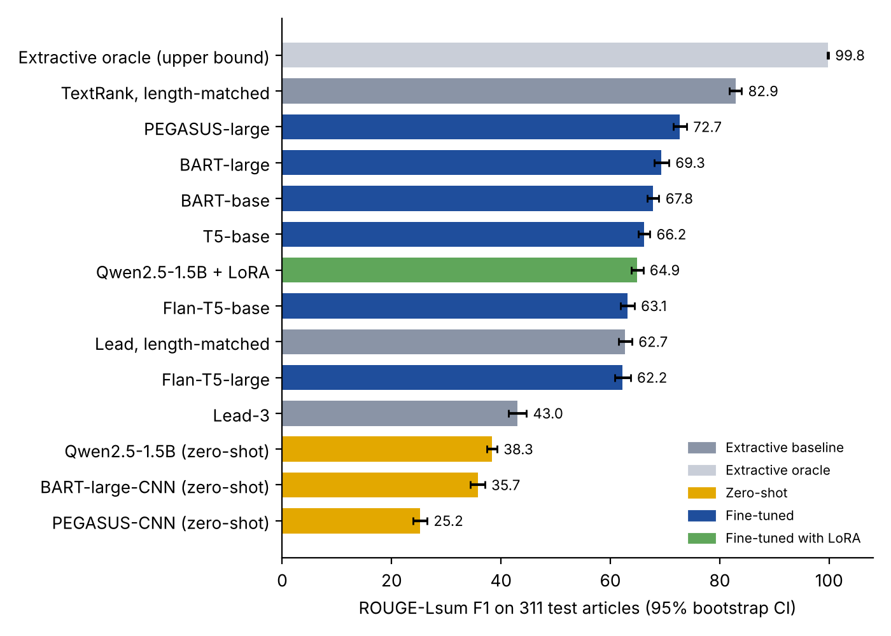
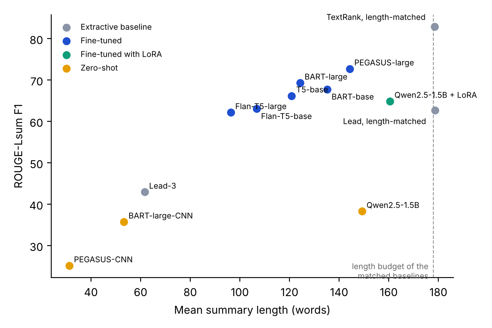

# NewsSum V2: Transformers, a Small LLM and Extractive Baselines on BBC News Summary

[](https://github.com/MHKhan50/NewsSum-Bench/actions/workflows/tests.yml)

[](LICENSE)
[](https://doi.org/10.5281/zenodo.24046039)

**Main finding:** a length-matched TextRank, which needs no training, scored
82.9 ROUGE-Lsum on the test set. The best fine-tuned model, PEGASUS-large,
scored 72.7. 95% of the reference sentences are copied word for word from the
article, so this benchmark mostly rewards picking the right sentences.

NewsSum compares ways of summarising news articles on the
[BBC News Summary](https://www.kaggle.com/datasets/pariza/bbc-news-summary)
dataset (2,225 BBC articles from 2004 and 2005, five categories, one reference
summary per article). V2 is a rebuild of the first version from scratch, with
a stricter protocol and a wider set of systems: simple extractive baselines,
summarisers used zero-shot, fine-tuned encoder-decoder transformers, and a
small instruction-tuned LLM, both zero-shot and fine-tuned with LoRA.

## Why V2

A review of the first version found problems that make its scores unusable:

1. **Swapped columns.** In the preprocessed CSV, the column named `title` holds
   the full article and `text` holds the reference summary. The models were
   therefore trained in the reverse direction (summary in, article out), and
   ROUGE was computed against the article.
2. **ROUGE arguments reversed** and the test rows chosen by file position, so
   they overlapped the randomly drawn training set.
3. **Duplicates.** The dataset contains repeated articles; with a random split
   copies end up in both training and test.
4. **Model names did not match the code** (for example, "BART-base" was
   `facebook/bart-large-cnn`), and the mT5 run had not converged.

V1 is kept in the git history (tag `v1.0.0`) and in the Zenodo record's first
version. Its results should not be cited.

## What V2 does

| # | Experiment | Question |
|---|---|---|
| 1 | Data audit | How many near-duplicates are there, how much would a naive split leak, and how were the references built? |
| 2 | Extractive baselines | Lead-3, length-matched Lead, length-matched TextRank, and a greedy extractive oracle (upper bound) |
| 3 | Zero-shot | BART-large-CNN and PEGASUS-CNN/DailyMail (trained on another news dataset), Qwen2.5-1.5B-Instruct |
| 4 | Fine-tuning | BART-base, BART-large, T5-base, Flan-T5-base, Flan-T5-large, PEGASUS-large; Qwen2.5-1.5B-Instruct with LoRA; 3 seeds each |
| 5 | Cross-category | BART-base trained on four categories, tested on the fifth |
| 6 | Evaluation | ROUGE-1/2/L/Lsum with 95% bootstrap CIs, paired comparison against Lead, BERTScore, copying statistics and unsupported numbers |

Design choices:

- **Near-duplicates are removed before splitting** (Jaccard similarity of word
  5-grams at least 0.9). The split is 70/15/15, stratified by category, with a
  fixed seed, and is the same for every system (`data/splits.csv` is written by
  the pipeline).
- **The headline is not part of the input.** Each article file starts with its
  headline; models see the body only.
- **Reference spacing is repaired.** The summary files join sentences without a
  space (`...$10.9bn.For the full year...`); this is fixed before scoring so that
  ROUGE-Lsum sees real sentence boundaries.
- **Length is set without looking at the reference.** Length-matched baselines
  and the LLM prompt use `ratio x article length`, where `ratio` is the median
  compression on the training split.
- **Fixed hyperparameters, no tuning on test data.** Models are selected by
  validation loss with early stopping; the test set is decoded once.
- **Scores are reported with uncertainty:** mean and standard deviation over
  three seeds, bootstrap CIs over test articles, and paired bootstrap
  differences against the Lead baseline.

## Results

All systems are scored on the same 311 test articles. Fine-tuned models are
averaged over three seeds (± is the standard deviation across seeds); the
interval is a 95% bootstrap CI over articles.

| System | Type | ROUGE-1 | ROUGE-2 | ROUGE-Lsum (95% CI) | BERTScore | Words |
|---|---|---|---|---|---|---|
| Extractive oracle | upper bound | 99.9 | 97.0 | 99.8 | 83.1 | 178 |
| **TextRank, length-matched** | extractive | **83.3** | **77.3** | **82.9** (81.7 to 84.0) | **67.1** | 179 |
| PEGASUS-large | fine-tuned | 73.6 | 64.5 | 72.7 ± 0.5 (71.5 to 74.0) | 59.0 | 144 |
| BART-large | fine-tuned | 70.0 | 62.6 | 69.3 ± 1.9 (68.0 to 70.7) | 58.3 | 124 |
| BART-base | fine-tuned | 68.8 | 59.0 | 67.8 ± 1.3 (66.8 to 68.9) | 54.5 | 135 |
| T5-base | fine-tuned | 67.2 | 57.9 | 66.2 ± 1.8 (65.1 to 67.2) | 54.1 | 121 |
| Qwen2.5-1.5B-Instruct + LoRA | fine-tuned | 66.2 | 53.8 | 64.9 ± 0.5 (63.8 to 66.0) | 48.0 | 160 |
| Flan-T5-base | fine-tuned | 64.0 | 55.6 | 63.1 ± 1.7 (61.8 to 64.4) | 52.6 | 107 |
| Lead, length-matched | extractive | 64.0 | 50.5 | 62.7 (61.5 to 63.9) | 44.5 | 179 |
| Flan-T5-large | fine-tuned | 62.9 | 55.8 | 62.2 ± 2.8 (60.8 to 63.7) | 53.7 | 96 |
| Lead-3 | extractive | 44.0 | 35.4 | 43.0 | 37.3 | 62 |
| Qwen2.5-1.5B-Instruct | zero-shot | 41.8 | 16.2 | 38.3 | 25.8 | 149 |
| BART-large-CNN | zero-shot | 37.0 | 25.8 | 35.7 | 30.0 | 53 |
| PEGASUS-CNN/DailyMail | zero-shot | 26.1 | 18.4 | 25.2 | 22.1 | 31 |



What the numbers say:

- **The references are extracted sentences.** 94.8% of reference sentences
  occur verbatim in the article, a reference is on average 45% as long as its
  article, and sentences near the start are kept more often (62% in the first
  tenth, 31% in the last tenth).
- **TextRank beats every trained model.** Against PEGASUS-large the paired
  difference is +10.2 ROUGE-Lsum (95% CI 8.7 to 11.5), +12.7 ROUGE-2 and +8.1
  BERTScore; TextRank scores higher on 81% of test articles.
- **Every fine-tuned model beats the length-matched Lead baseline on ROUGE-2**
  (by 3.3 to 14.0 points), but on ROUGE-Lsum Flan-T5-base (+0.4, CI −1.3 to 2.0)
  and Flan-T5-large (−0.5, CI −2.4 to 1.3) do not.
- **Shorter outputs score lower.** The fine-tuned models copy almost all their
  words from the article (coverage 0.99 or more) but write 96 to 160 words where
  the length-matched baselines write about 179. Flan-T5-large writes the shortest
  summaries and, despite being larger, scores below Flan-T5-base.
- **Zero-shot models fail on length and wording.** The CNN/DailyMail models
  write 31 to 53 words. The zero-shot Qwen model writes in its own words (73% new
  word pairs) and 7.8% of its numbers do not appear in the article; after LoRA
  fine-tuning this falls to 0.8%.
- **Duplicates matter.** 154 of 2,225 articles are near-duplicates (138 exact).
  Without de-duplication, a random 85/15 split puts a copy of 11.5% of test
  articles into training.
- **Topic shift costs little.** BART-base trained without one topic lost 1.0 to
  3.4 ROUGE-Lsum points on that topic; only business (−3.4, CI −5.9 to −0.6) is
  clearly below zero.



Files in [`results/`](results): `main.csv` (all metrics), `by_category.csv`,
`cross_category.csv`, `training.csv`, the audit tables (`audit_*.csv`),
`per_document_scores.csv.gz`, the fixed split (`splits.csv`), one JSON per run
in `runs/`, and the figures. Compute: two Kaggle sessions on 2 × T4 GPUs (about 18 hours wall-clock, 31 GPU-hours of training and generation).

## Models and demo

- Browser demo (TextRank and BART-base side by side, runs locally in the browser):
  [huggingface.co/spaces/MHkhan50/newssum-demo](https://huggingface.co/spaces/MHkhan50/newssum-demo)
- [PEGASUS-large](https://huggingface.co/MHkhan50/newssum-pegasus-large-bbc), the best fine-tuned model
- [BART-base](https://huggingface.co/MHkhan50/newssum-bart-base-bbc), with a quantised ONNX copy for Transformers.js
- [Qwen2.5-1.5B-Instruct LoRA adapter](https://huggingface.co/MHkhan50/newssum-qwen2.5-1.5b-lora-bbc)

All three are the seed-0 checkpoints from the study. They were published with
[`notebooks/publish_huggingface.ipynb`](notebooks/publish_huggingface.ipynb).

## Run it

**On Kaggle (recommended).** The run behind these results is public:
[NewsSum V2 on Kaggle](https://www.kaggle.com/code/muzammalhussain11/newssum-v2-bbc-news-summarisation-benchmark).
To run it yourself, import
[`notebooks/newssum_v2_kaggle.ipynb`](notebooks/newssum_v2_kaggle.ipynb) from
this repository (*File → Import Notebook → GitHub*), then:

1. Accelerator **GPU T4 x2**, Internet **On**, and add the dataset
   `pariza/bbc-news-summary`.
2. Run once with `MODE = "smoke"` (about 10 minutes) to check the setup.
3. Set `MODE = "full"` and *Save Version → Save & Run All*.

The full plan needs more than one 12-hour session. Each (model, seed) is a
separate job: finished jobs are stored with their predictions and scores, and
a job that is still running when the time limit approaches saves a checkpoint.
To continue, add the previous version's output to the notebook as input and run
it again; finished jobs are skipped and unfinished ones resume where they
stopped. With two GPUs, two jobs run in parallel.

**Locally** (CPU is enough for the audit, baselines and tests):

```bash
pip install -e ".[dev]"            # audit, baselines, metrics, tests
pip install -e ".[train]"          # + PyTorch, transformers, PEFT, BERTScore
python scripts/run_experiments.py --data "path/to/BBC News Summary" --out outputs --cpu-only
pytest                             # offline tests on synthetic data
NEWSSUM_SMOKE=1 pytest -m smoke    # end-to-end run with tiny models (needs internet)
```

## Repository structure

```
src/newssum/   package: data, audit, baselines, metrics, models, training engine, runner, report
notebooks/     Kaggle notebook
scripts/       command-line entry point
tests/         offline tests (synthetic data in the dataset's folder layout) and a tiny-model smoke test
results/       tables, per-document scores, run records and figures
paper/         LaTeX source and PDF of the preprint
huggingface/   model cards and the browser demo published to Hugging Face
data/          data instructions (the dataset is not redistributed here)
```

## Limitations

- BBC News Summary is small (about 2,100 articles after de-duplication) and
  covers two years of one publisher.
- Its reference summaries are made of sentences taken from the article, so
  ROUGE against them favours copying. The audit and the copying statistics are
  there to make this visible rather than to hide it. A higher score here does
  not mean a better summary for a reader.
- Hyperparameters were fixed in advance and not tuned; generation length was
  not controlled for the fine-tuned models.
- ROUGE and BERTScore do not measure factual consistency; the unsupported-number
  rate is only a rough check.

## Citation

Hussain, M. (2026). *NewsSum V2: Transformers, a Small LLM and Extractive
Baselines on BBC News Summary*. Zenodo. https://doi.org/10.5281/zenodo.24046039

See also [`CITATION.cff`](CITATION.cff). Please also cite the dataset:

> D. Greene and P. Cunningham. *Practical Solutions to the Problem of Diagonal
> Dominance in Kernel Document Clustering.* Proc. ICML 2006 (the BBC articles),
> and the BBC News Summary dataset on Kaggle (`pariza/bbc-news-summary`), which
> adds an extractive summary to each article.

## Licence

Code: MIT. The BBC articles belong to the BBC and are used here for research
only; they are not included in this repository.
